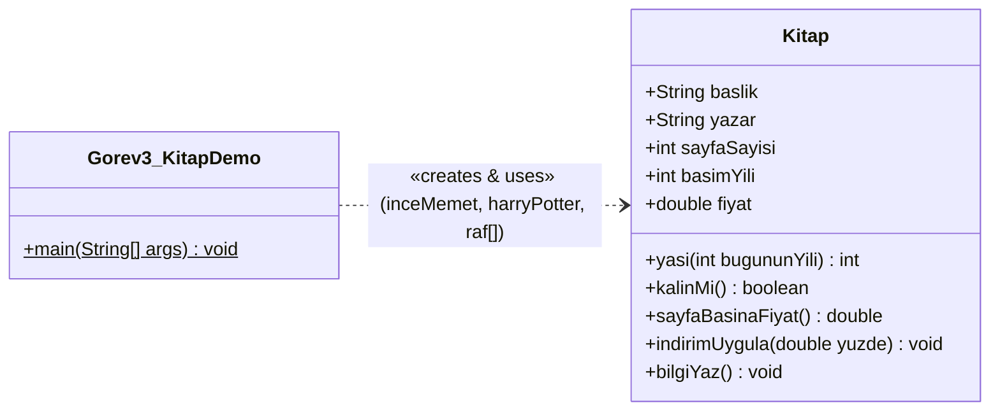

# ☕ Nesne Yönelimli Programlama — Hafta 01 Laboratuvar Çalışması ve Vize Rehberi


Bu depo (`Hafta_01_lab`), **Karadeniz Teknik Üniversitesi (KTÜ) Of Teknoloji Fakültesi Yazılım Mühendisliği Bölümü** 2. Sınıf Güz Dönemi **Nesne Yönelimli Programlama (OOP)** dersinin 1. Hafta Laboratuvar çalışmalarını, kaynak kodlarını, karşılaşılan derleme/çalışma zamanı hatalarını ve vize sınavına yönelik teorik ders notlarını içerir.

| Kategori | Detay |
| :--- | :--- |
| **Ders Adı** | Nesne Yönelimli Programlama (Zorunlu) |
| **Dönem / Sınıf** | 2026–2027 Güz Dönemi · 2. Sınıf |
| **Öğretim Elemanı** | Dr. Öğr. Üyesi Rıfat BENVENİSTE |
| **Laboratuvar Sorumlusu** | Arş. Gör. Betül MUMCU |
| **Geliştirme Ortamı** | JDK 21 (LTS) · Visual Studio Code + Extension Pack for Java |

> [!NOTE]
> **Proje Dizin Mimarisi ve Derleme Kuralı**
> Laboratuvar standartları gereği kaynak kodlar (`.java`) `src/` klasöründe, derlenmiş bayt kodları (`.class`) ise `bin/` klasöründe tutulmaktadır. Tüm projeyi tek seferde derlemek ve çalıştırmak için aşağıdaki komutlar kullanılır:
> ```bash
> # Tüm kaynak dosyaları derleyip .class çıktılarını bin/ dizinine yönlendirir
> javac -d bin src/*.java
>
> # İlgili sınıfı bin/ sınıf yolundan (classpath) çalıştırır
> java -cp bin Gorev1_Kimlik
> ```

## 📂 Depo İçeriği ve Görev Matrisi

| Görev | Dosya Adı | Temel Kazanım ve Odak Noktası | Durum |
| :--- | :--- | :--- | :--- |
| **Görev 0 & 1** | `src/Gorev1_Kimlik.java` | JDK 21 doğrulaması, `javac`/`java` kullanımı ve `System.out.printf` ile hizalı çıktı üretimi | Tamamlandı |
| **Görev 2** | `src/Gorev2_NotIstatistik.java` | Prosedürel C kodunun Java'ya taşınması, `dizi.length`, `for-each` ve tür dönüşümü (type casting) | Tamamlandı |
| **Görev 3** | `src/Kitap.java`<br>`src/Gorev3_KitapDemo.java` | Sınıf (Class) ve Nesne (Object) tasarımı, durum (state) & davranış (behavior), nesne dizileri | Tamamlandı |
| **Görev 4** | `src/Sicaklik_2.java`<br>`src/Gorev4_SicaklikDemo.java` | Stack ve Heap bellek mimarisi, referans semantiği (aliasing), derin kopya ve metoda referans aktarma | Tamamlandı |
| **Görev 5 (Bonus)** | `src/Urun.java`<br>`src/Gorev5_SepetDemo.java` | `Scanner` ile veri okuma, `Locale.US` yapılandırması ve nesne dizisi üzerinde sepet analizi | Tamamlandı |

## 🛠️ Görev 0 & Görev 1: Ortam Doğrulaması ve Biçimli Çıktı (`Gorev1_Kimlik.java`)

### 🎯 Amaç ve Tasarım Yaklaşımı
İlk görevde komut satırından JDK 21 kurulumu (`java -version` ve `javac -version`) doğrulanmış, ardından öğrenci bilgilerini değişkenlerde tutarak `System.out.printf` format belirteçleriyle **39 karakter iç çerçeve genişliğine** sahip sabit hizalı bir öğrenci kimlik kartı oluşturulmuştur.

| Biçim Belirteci | Veri Tipi | Görevi ve Hizalama Davranışı |
| :--- | :--- | :--- |
| `%-27s` | `String` | Metni **27 karakterlik** alana **sola yaslı** (`-`) olarak yerleştirir; kalan kısmı boşlukla doldurur. |
| `%-27d` | `int` | Tam sayıyı **27 karakterlik** alana **sola yaslı** olarak yazar. |
| `%-27.2f` | `double` | Ondalıklı sayıyı virgülden sonra **2 basamak** (`.2`) yuvarlayarak **27 karakterlik** alana sola yaslar. |
| `%n` | Platform Bağımsız | İşletim sistemine özgü satır sonu karakterini (Windows'ta `\r\n`, Linux/macOS'ta `\n`) üretir. |

### 💻 Kaynak Kod: `Gorev1_Kimlik.java`

```java
/**
 * KTÜ Of Teknoloji Fakültesi - Yazılım Mühendisliği
 * Nesne Yönelimli Programlama - Hafta 01 Laboratuvarı
 * Görev 1: İlk Program ve Biçimli Çıktı
 */
public class Gorev1_Kimlik {
    public static void main(String[] args) {
        String adSoyad = "Ali Yilmaz";
        int numara = 331001;
        String bolum = "Yazilim Muhendisligi";
        double ortalama = 3.12;

        // Çerçeve iç genişliği: 39 karakter ('|' karakterleri arası)
        // Sol boşluk (1) + Etiket (10) + Değer alanı (27) + Sağ boşluk (1) = 39 karakter
        System.out.printf("+---------------------------------------+%n");
        System.out.printf("| %-37s |%n", "OGRENCI KIMLIK KARTI");
        System.out.printf("+---------------------------------------+%n");
        System.out.printf("| Ad Soyad: %-27s |%n", adSoyad);
        System.out.printf("| Numara  : %-27d |%n", numara);
        System.out.printf("| Bolum   : %-27s |%n", bolum);
        System.out.printf("| Ortalama: %-27.2f |%n", ortalama);
        System.out.printf("+---------------------------------------+%n");
    }
}
```

#### 🖥️ Terminal Çıktısı
```text
+---------------------------------------+
| OGRENCI KIMLIK KARTI                  |
+---------------------------------------+
| Ad Soyad: Ali Yilmaz                  |
| Numara  : 331001                      |
| Bolum   : Yazilim Muhendisligi        |
| Ortalama: 3.12                        |
+---------------------------------------+
```

### ⚠️ Karşılaşılan Kritik Hatalar ve Çözümleri
* **`javac` Komutunun Tanınmaması:** Sistemde yalnızca JRE (Java Runtime Environment) kurulu olduğunda veya `JAVA_HOME/bin` dizini işletim sisteminin `PATH` ortam değişkenine eklenmediğinde ortaya çıkar. JDK 21 LTS kurulumu ve ortam değişkeni doğrulamasıyla çözülmüştür.
* **Sağ Çerçeve (`|`) Kayması:** `%-27s` yerine `%27s` kullanıldığında metin sağa yaslanır; etiket uzunlukları eşitlenmediğinde ise sağdaki `|` karakteri her satırda farklı sütuna düşer. Etiketler 10 karaktere (`Ad Soyad: `, `Numara  : `) sabitlenip `%-27s` ile toplam 39 karakterlik iç genişlik korunmuştur.

### 🎯 Vize Sınavı Hap Notları (Görev 1 Kontrol Soruları)

> [!IMPORTANT]
> **Soru 1: `println` ile `printf` arasındaki fark nedir? `printf` yerine `println` kullansaydınız hangi ek işi yapmanız gerekirdi?**
> * `System.out.println` verilen değeri doğrudan metne çevirip ekrana basar ve alt satıra geçer; sütun genişliği sabitleme veya ondalık basamak yuvarlama yeteneği yoktur.
> * `System.out.printf` (*Print Formatted*) ise biçim belirteçleri (`%-27s`, `%.2f`) sayesinde veriyi belirli bir karakter genişliğine hizalar ve biçimlendirir.
> * Eğer `println` kullanılsaydı, her değişkenin karakter uzunluğunu (`String.length()`) hesaplayıp 27 karakterden çıkararak eksik kalan boşlukları `for` döngüsü veya `.repeat()` metoduyla **manuel olarak** eklemek ve ondalık sayıyı `Math.round()` ile ayrıca yuvarlamak gerekirdi.

> [!TIP]
> **Soru 2: `%n` yerine `\n` yazsaydınız ne değişirdi? Hangi durumda fark ortaya çıkar?**
> * `\n` (*Line Feed - LF*) her işletim sisteminde sabit olarak yalnızca `0x0A` karakterini üretir.
> * `%n` ise JVM'nin çalıştığı işletim sisteminin yerel satır sonu dizilimini dinamik olarak seçer: **Linux/macOS** üzerinde `\n`, **Windows** üzerinde ise `\r\n` (*Carriage Return + Line Feed - CRLF*) üretir.
> * Konsol ekranında çoğu modern terminal bu farkı tolere etse de, program çıktısı bir dosyaya yönlendirildiğinde (`java Gorev1_Kimlik > cikti.txt`) veya işletim sistemine özgü metin araçlarıyla okunduğunda `\n` kullanımı Windows'ta satırların bitişik görünmesine ya da satır sonu uyumsuzluğuna yol açar.

## 🔄 Görev 2: C'den Java'ya Geçiş (`Gorev2_NotIstatistik.java`)

### 🎯 Amaç ve Tasarım Yaklaşımı
C dilinde yazılmış prosedürel `not_istatistik.c` programı Java'ya taşınarak iki dil arasındaki bellek güvenliği, dizi yönetimi ve sözdizimi farkları uygulanmıştır.

| C Dilindeki Yapı (`not_istatistik.c`) | Java Karşılığı (`Gorev2_NotIstatistik.java`) | Mimari Gerekçe |
| :--- | :--- | :--- |
| `#include <stdio.h>` | Kaldırıldı (`java.lang.System` otomatik yüklenir) | Standart G/Ç işlemleri `System.out` üzerinden doğrudan erişilebilirdir. |
| `#define N 8` | Kaldırıldı (`dizi.length` kullanıldı) | Java'da diziler birer nesnedir ve boyut bilgisini kendi bünyesinde (`length` alanı) taşır. |
| `double ortalama(int dizi[], int n)` | `public static double ortalama(int[] dizi)` | Dizi kendi boyutunu bildiği için metoda ayrıca `int n` göndermek gereksizdir. |
| `int en_buyuk(int dizi[], int n)` | `public static int enBuyuk(int[] dizi)` | C tarzı `snake_case` yerine Java standartlarına uygun `camelCase` adlandırma uygulandı. |
| `int notlar[N] = {...};` | `int[] notlar = {...};` | Java'da dizi tanımında köşeli parantez tür adıyla birlikte (`int[]`) yazılır ve boyut belirtilmez. |
| `return 0;` (`main` sonunda) | Kaldırıldı (`public static void main`) | Java'da `main` metodu `void` döner; çıkış kodu gerekirse `System.exit(0)` kullanılır. |

### 💻 Kaynak Kod: `Gorev2_NotIstatistik.java`

```java
/**
 * KTÜ Of Teknoloji Fakültesi - Yazılım Mühendisliği
 * Nesne Yönelimli Programlama - Hafta 01 Laboratuvarı
 * Görev 2: C Programını Java'ya Çevirme ve Dizi İstatistikleri
 */
public class Gorev2_NotIstatistik {

    // Notların aritmetik ortalamasını hesaplar (Tam sayı bölmesi tuzağına karşı double cast)
    public static double ortalama(int[] dizi) {
        int toplam = 0;
        for (int i = 0; i < dizi.length; i++) {
            toplam += dizi[i];
        }
        return (double) toplam / dizi.length;
    }

    // Gelişmiş for (for-each) döngüsü ile dizideki en yüksek notu bulur
    public static int enBuyuk(int[] dizi) {
        int enb = dizi[0];
        for (int sayi : dizi) {
            if (sayi > enb) {
                enb = sayi;
            }
        }
        return enb;
    }

    // Föy Ek Gereksinimi 1: Dizideki en düşük notu bulan metot
    public static int enKucuk(int[] dizi) {
        int enk = dizi[0];
        for (int sayi : dizi) {
            if (sayi < enk) {
                enk = sayi;
            }
        }
        return enk;
    }

    // Gelişmiş for (for-each) döngüsü ile geçme notu ve üzerindeki öğrenci sayısını döner
    public static int gecenSayisi(int[] dizi, int gecme) {
        int sayac = 0;
        for (int sayi : dizi) {
            if (sayi >= gecme) {
                sayac++;
            }
        }
        return sayac;
    }

    // Föy Ek Gereksinimi 2: Diziyi [68, 74, 91, ...] biçiminde tek satırda yazdırır
    public static void notlariYazdir(int[] dizi) {
        System.out.print("Notlar      : [");
        for (int i = 0; i < dizi.length; i++) {
            System.out.print(dizi[i]);
            if (i < dizi.length - 1) {
                System.out.print(", ");
            }
        }
        System.out.printf("]%n");
    }

    public static void main(String[] args) {
        int[] notlar = {68, 74, 91, 55, 80, 43, 97, 62};

        notlariYazdir(notlar);
        System.out.printf("Ortalama    : %.2f%n", ortalama(notlar));
        System.out.printf("En yuksek   : %d%n", enBuyuk(notlar));
        System.out.printf("En dusuk    : %d%n", enKucuk(notlar));
        System.out.printf("Gecen sayisi: %d%n", gecenSayisi(notlar, 50));
    }
}
```

#### 🖥️ Terminal Çıktısı
```text
Notlar      : [68, 74, 91, 55, 80, 43, 97, 62]
Ortalama    : 71.25
En yuksek   : 97
En dusuk    : 43
Gecen sayisi: 7
```

### ⚠️ Karşılaşılan Kritik Hatalar ve Çözümleri
* **Tam Sayı Bölmesi Tuzağı (Integer Division Trap):** `toplam` (`int`) ve `dizi.length` (`int`) doğrudan bölündüğünde (`570 / 8`), Java iki tam sayının bölümünden ondalık kısmı kesip atar (*truncation*) ve `71.25` yerine `71.00` üretir. Bölme işleminden önce `(double) toplam / dizi.length` yazılarak terimlerden biri `double` tipine yükseltilmiş (*type promotion*) ve hassas sonuç elde edilmiştir.

### 🎯 Vize Sınavı Hap Notları (Görev 2 Kontrol Soruları)

> [!IMPORTANT]
> **Soru 1: C sürümünde `n` parametresini taşımak zorundaydınız; Java'da neden gerek yok?**
> * **C Dilinde:** Diziler bir fonksiyona argüman olarak gönderildiğinde **Pointer Decay** (işaretçiye indirgenme) gerçekleşir; fonksiyon yalnızca dizinin ilk elemanının bellek adresini (`int *dizi`) alır ve dizinin nerede bittiğini bilemez. Bu yüzden eleman sayısı (`int n`) dışarıdan taşınmak zorundadır.
> * **Java Dilinde:** Diziler Heap bellekte yaşayan birinci sınıf **nesnelerdir**. Her dizi nesnesi oluşturulurken boyutu nesne başlığına (*object header*) kaydedilir ve `dizi.length` özelliğiyle çalışma zamanında doğrudan okunabilir.

> [!WARNING]
> **Soru 2: `for (int sayi : dizi)` (for-each) yazımını hangi durumlarda kullanamazsınız?**
> Gelişmiş `for-each` döngüsü yalnızca ileri yönlü ve salt-okunur (*read-only*) gezinmeler için uygundur. Şu **5 senaryoda kullanılamaz**:
> 1. **Dizi elemanını değiştirmek gerektiğinde:** Döngü değişkeni (`sayi`) dizi elemanının bir kopyasını tutar; `sayi = 100;` yazmak dizinin içindeki gerçek elemanı değiştirmez.
> 2. **İndis numarasına ihtiyaç duyulduğunda:** Örneğin `notlariYazdir` metodunda son elemandan sonra virgül koymamak için `i < dizi.length - 1` kontrolü gerektiğinde.
> 3. **Ters sırada veya atlamalı gezinmede:** Diziyi sondan başa (`i--`) veya ikişer atlayarak (`i += 2`) gezmek istendiğinde.
> 4. **Kısmi aralık taramasında:** Dizinin tamamı yerine yalnızca belirli bir alt aralığında (ör. 2. indisten 5. indise kadar) dönülmek istendiğinde.
> 5. **Birden fazla diziyi paralel gezerken:** İki farklı dizinin aynı indisli elemanlarını (`a[i]` ve `b[i]`) aynı anda karşılaştırmak gerektiğinde.

> [!IMPORTANT]
> **Soru 3: Dizide olmayan bir indise (`notlar[8]`) erişmeye çalışırsanız C ve Java'da ne olur?**
> * **C Dilinde (Bellek Güvensiz):** Derleyici veya çalışma zamanı dizi sınır kontrolü (*bounds checking*) yapmaz. `notlar[8]` ifadesi `*(notlar + 8)` adres aritmetiğine dönüşür ve dizinin bittiği yerin hemen yanındaki bellek hücresini okur. Sonuç **Tanımsız Davranıştır (Undefined Behavior)**: ya bellekten anlamsız **çöp veri (garbage value)** okunur, ya başka bir değişkenin üzerine yazılır (*buffer overflow*), ya da işletim sistemi tarafından korunan bir bölgeye girilirse `Segmentation Fault (SIGSEGV)` ile program çöker.
> * **Java Dilinde (Bellek Güvenli):** JVM her dizi erişiminde otomatik sınır kontrolü yapar (`0 <= index < dizi.length`). 8 elemanlı dizide geçerli indisler `0..7` olduğu için `notlar[8]` erişiminde bellek bozulmasına izin verilmez ve anında **`ArrayIndexOutOfBoundsException`** çalışma zamanı istisnası fırlatılır.

## 📚 Görev 3: İlk Sınıf ve Nesne (`Kitap.java` & `Gorev3_KitapDemo.java`)

### 🎯 Amaç ve Tasarım Yaklaşımı
Nesne Yönelimli Programlamanın temel yapı taşı olan **Sınıf (Class)** kavramı modellenmiş; **Durum (State / Alanlar)** ve **Davranış (Behavior / Metotlar)** ayrımı gözetilerek `Kitap` şablonu oluşturulmuştur. Ayrıca **değer döndüren (accessor/query)** metotlar ile **durum değiştiren (mutator)** metotlar arasındaki fark uygulanmıştır.

### 📐 Sınıf Mimarisi (Mermaid Class Diagram)



### 💻 Kaynak Kodlar

#### 1. `src/Kitap.java` (Sınıf Şablonu)
```java
/**
 * KTÜ Of Teknoloji Fakültesi - Yazılım Mühendisliği
 * Nesne Yönelimli Programlama - Hafta 01 Laboratuvarı
 * Görev 3a: Kitap Sınıfı Tanımı
 */
public class Kitap {
    // Özellikler (State / Instance Fields) - Her nesne için Heap'te ayrı tutulur
    public String baslik;
    public String yazar;
    public int sayfaSayisi;
    public int basimYili;
    public double fiyat;

    // Değer döndüren metot: Basımından bu yana geçen yıl sayısını hesaplar
    public int yasi(int bugununYili) {
        return bugununYili - basimYili;
    }

    // Değer döndüren metot: Sayfa sayısı 400'den büyükse true döner
    public boolean kalinMi() {
        return sayfaSayisi > 400;
    }

    // Değer döndüren metot: Nesnenin durumunu değiştirmez, birim sayfa maliyetini hesaplar
    public double sayfaBasinaFiyat() {
        return fiyat / sayfaSayisi;
    }

    // Durum değiştiren (Mutator) metot: Sınır kontrolü yapar ve nesnenin fiyat alanını kalıcı günceller
    public void indirimUygula(double yuzde) {
        if (yuzde < 0 || yuzde > 100) {
            System.out.printf("UYARI: Gecersiz indirim orani (%%%.1f)! Oran 0-100 arasinda olmalidir.%n", yuzde);
            return;
        }
        fiyat = fiyat - (fiyat * yuzde / 100.0);
    }

    // Durum değiştirmeyen metot: Kitap bilgilerini tek satırda biçimli olarak ekrana basar
    public void bilgiYaz() {
        System.out.printf("%-22s | %-16s | %4d syf | %4d | %6.2f TL | Kalin: %-5b%n",
                baslik, yazar, sayfaSayisi, basimYili, fiyat, kalinMi());
    }
}
```

#### 2. `src/Gorev3_KitapDemo.java` (Test ve Nesne Dizisi Sınıfı)
```java
/**
 * KTÜ Of Teknoloji Fakültesi - Yazılım Mühendisliği
 * Nesne Yönelimli Programlama - Hafta 01 Laboratuvarı
 * Görev 3b: Kitap Nesnelerinin Oluşturulması ve Nesne Dizisi Kullanımı
 */
public class Gorev3_KitapDemo {
    public static void main(String[] args) {
        // 1. İki ayrı Kitap nesnesinin oluşturulması ve alanlarına değer atanması
        Kitap inceMemet = new Kitap();
        inceMemet.baslik = "Ince Memet 1";
        inceMemet.yazar = "Yasar Kemal";
        inceMemet.sayfaSayisi = 436;
        inceMemet.basimYili = 1955;
        inceMemet.fiyat = 250.00;

        Kitap harryPotter = new Kitap();
        harryPotter.baslik = "Felsefe Tasi";
        harryPotter.yazar = "J.K. Rowling";
        harryPotter.sayfaSayisi = 276;
        harryPotter.basimYili = 1997;
        harryPotter.fiyat = 180.00;

        // 2. İlk durum bilgilerinin yazdırılması
        System.out.println("=== INDIRIM ONCESI KITAP LISTESI ===");
        inceMemet.bilgiYaz();
        harryPotter.bilgiYaz();

        // 3. Birinci kitabın yaşı ve sayfa başına fiyatının yazdırılması
        System.out.printf("%n'%s' Kitabinin Yasi (2026): %d yil%n",
                inceMemet.baslik, inceMemet.yasi(2026));
        System.out.printf("'%s' Sayfa Basina Fiyat  : %.2f TL%n",
                inceMemet.baslik, inceMemet.sayfaBasinaFiyat());

        // Sınır durumu testi: Geçersiz indirim oranı
        inceMemet.indirimUygula(120);

        // 4. Her iki kitaba %20 indirim uygulanması ve yeniden yazdırılması
        inceMemet.indirimUygula(20);
        harryPotter.indirimUygula(20);

        System.out.println("\n=== %20 INDIRIM SONRASI KITAP LISTESI ===");
        inceMemet.bilgiYaz();
        harryPotter.bilgiYaz();

        // 5. Nesne dizisi (Kitap[]) oluşturma ve raftaki toplam değeri hesaplama
        Kitap[] raf = {inceMemet, harryPotter};
        double toplamDeger = 0.0;
        for (Kitap k : raf) {
            toplamDeger += k.fiyat;
        }
        System.out.printf("%nRaftaki Kitaplarin Toplam Degeri: %.2f TL%n", toplamDeger);
    }
}
```

#### 🖥️ Terminal Çıktısı
```text
=== INDIRIM ONCESI KITAP LISTESI ===
Ince Memet 1           | Yasar Kemal      |  436 syf | 1955 | 250.00 TL | Kalin: true 
Felsefe Tasi           | J.K. Rowling     |  276 syf | 1997 | 180.00 TL | Kalin: false

'Ince Memet 1' Kitabinin Yasi (2026): 71 yil
'Ince Memet 1' Sayfa Basina Fiyat  : 0.57 TL
UYARI: Gecersiz indirim orani (%120.0)! Oran 0-100 arasinda olmalidir.

=== %20 INDIRIM SONRASI KITAP LISTESI ===
Ince Memet 1           | Yasar Kemal      |  436 syf | 1955 | 200.00 TL | Kalin: true 
Felsefe Tasi           | J.K. Rowling     |  276 syf | 1997 | 144.00 TL | Kalin: false

Raftaki Kitaplarin Toplam Degeri: 344.00 TL
```

### ⚠️ Karşılaşılan Kritik Hatalar ve Çözümleri

> [!WARNING]
> **Kritik Hata: `The static field Kitap.baslik should be accessed in a static way`**
> * **Hatanın Nedeni:** `Kitap` sınıfındaki özellikler tanımlanırken yanlışlıkla `public static String baslik;` şeklinde `static` anahtar kelimesi kullanıldığında ortaya çıkar. Bir alan `static` yapıldığında nesneye (*instance*) değil **sınıfın kendisine** ait olur ve bellekte yalnızca **1 adet** oluşturulur. Bu durumda `harryPotter.baslik = "Felsefe Tasi"` ataması yapıldığında `inceMemet.baslik` değeri de ezilir!
> * **Çözüm:** `Kitap` sınıfındaki tüm alanlardan `static` anahtar kelimesi kaldırılarak **Örnek Değişkeni (Instance Variable)** haline getirilmiştir. Böylece `new Kitap()` ile üretilen her nesne Heap bellekte kendi bağımsız alanlarına sahip olmuştur.

* **`cannot find symbol: class Kitap`:** `Gorev3_KitapDemo.java` tek başına derlenmeye çalışıldığında derleyici `Kitap` sınıfını bulamaz. Çözüm olarak `javac -d bin src/*.java` komutuyla tüm kaynak dosyalar birlikte derlenmiştir.

### 🎯 Vize Sınavı Hap Notları (Görev 3 Kontrol Soruları)

> [!IMPORTANT]
> **Soru 1: `Kitap.java` dosyasında neden `main` metodu yok? Bu dosyayı doğrudan çalıştırmaya kalkarsanız ne olur?**
> * `Kitap.java` tek başına çalışan bir program değil, nesne üretmek için tasarlanmış bir **sınıf şablonudur (blueprint/model)**. Uygulamanın başlangıç noktası (*entry point*) sürücü sınıf olan `Gorev3_KitapDemo` içindedir.
> * `javac` ile derlenir (`Kitap.class` oluşur), ancak `java -cp bin Kitap` komutuyla doğrudan çalıştırılmaya kalkılırsa JVM başlangıç noktasını bulamaz ve şu hatayı verir:
>   `Error: Main method not found in class Kitap, please define the main method as: public static void main(String[] args)`

> [!TIP]
> **Soru 2: `kalinMi()` metodunu bir `boolean` özellik (`public boolean kalin;`) olarak da tanımlayabilirdiniz. Metot olarak yazmanın avantajı nedir?**
> * **Veri Tutarlılığı (Data Consistency / Single Source of Truth):** Kalın olma durumu doğrudan `sayfaSayisi` alanına bağlı türetilmiş bir bilgidir (*derived attribute*). Eğer `boolean kalin` ayrı bir değişken olarak tutulsaydı, ileride `kitap.sayfaSayisi = 500;` şeklinde sayfa sayısı değiştirildiğinde `kitap.kalin = true;` güncellemesi unutulursa nesne **tutarsız duruma (inconsistent state)** düşerdi (500 sayfalı ama `kalin == false`).
> * **Bellek Tasarrufu:** Her nesnede fazladan bir `boolean` alan saklamak yerine, `kalinMi()` çağrıldığı anda güncel `sayfaSayisi > 400` kontrolünü dinamik olarak hesaplar.

> [!IMPORTANT]
> **Soru 3: İki `Kitap` nesnesinin `bilgiYaz()` metodu aynı kod olduğu hâlde neden farklı çıktı üretir?**
> * Bellekte `bilgiYaz()` metodunun makine kodu (Metot Alanı / *Method Area* içinde) tek bir kopyadır; ancak bir nesne üzerinden `inceMemet.bilgiYaz()` veya `harryPotter.bilgiYaz()` çağrıldığında Java derleyicisi metoda gizli bir **`this` referansı** (çağrıyı yapan nesnenin Heap adresi) geçirir.
> * Metot içindeki `baslik`, `yazar`, `fiyat` ifadeleri aslında `this.baslik`, `this.yazar`, `this.fiyat` anlamına gelir. Her nesnenin Heap'teki adresi ve o adresteki alan değerleri farklı olduğu için aynı metot kodu çağrıldığı nesneye özgü çıktı üretir.

## 🧠 Görev 4: Referans Semantiği Deneyi (`Sicaklik_2.java` & `Gorev4_SicaklikDemo.java`)

### 🎯 Amaç ve Tasarım Yaklaşımı
Java'da ilkel tiplerin (*primitive types*: `int`, `double`, `boolean`) Stack'te doğrudan **değer** tuttuğu, nesne değişkenlerinin (*reference types*) ise nesnenin kendisini değil **Heap bellekteki referansını (adresini)** tuttuğu üç aşamalı deneyle kanıtlanmıştır:
1. **Deney A (İki Referans, Tek Nesne — Aliasing):** Referans atamasının (`s3 = s1`) nesneyi kopyalamadığını, aynı Heap adresini paylaştırdığını gözlemlemek.
2. **Deney B (Gerçek Kopya — Deep/Value Copy):** `new` anahtar kelimesiyle ikinci bir Heap alanı tahsis ederek bağımsız nesne üretmek.
3. **Deney C (Metoda Referans Geçirme — Pass-by-Value of Reference):** Metoda gönderilen nesne referansı üzerinden yapılan alan değişikliklerinin kalıcı olarak orijinal nesneye yansıdığını doğrulamak.

### 🗺️ Stack ve Heap Bellek Mimarisi (ASCII Şeması)

```text
================================================================================
              DENEY A: İKİ REFERANS, TEK NESNE (Sicaklik_2 s3 = s1;)
================================================================================
        YIĞIN (STACK)                                  ÖBEK (HEAP)
   [main() Metot Çerçevesi]                     [new ile Üretilen Nesneler]
+----------------------------+               +---------------------------------+
| s1  |  @1a2b3c  -----------+-------------->| Sicaklik_2 Nesnesi (@1a2b3c)    |
+----------------------------+               |---------------------------------|
| s3  |  @1a2b3c  -----------+-------------->| celsius : 25.0  ==[isit(10)]==> |
+----------------------------+               | celsius : 35.0                  |
                                             +---------------------------------+
  * s1 == s3  ---> (@1a2b3c == @1a2b3c) ---> true (Aynı nesneyi işaret ederler!)
  * Bellekte toplam 1 adet Sicaklik_2 nesnesi vardır.

================================================================================
         DENEY B: GERÇEK KOPYA (s2 = new Sicaklik_2(); s2.celsius = s1.celsius;)
================================================================================
        YIĞIN (STACK)                                  ÖBEK (HEAP)
   [main() Metot Çerçevesi]                     [Birbirinden Bağımsız 2 Nesne]
+----------------------------+               +---------------------------------+
| s1  |  @1a2b3c  -----------+-------------->| Sicaklik_2 Nesnesi (@1a2b3c)    |
+----------------------------+               | celsius : 35.0  (DEĞİŞMEZ!)     |
| s3  |  @1a2b3c  -----------+               +---------------------------------+
+----------------------------+
| s2  |  @4d5e6f  -----------+-------------->+---------------------------------+
+----------------------------+               | Sicaklik_2 Nesnesi (@4d5e6f)    |
                                             | celsius : 35.0  ==[isit(10)]==> |
                                             | celsius : 45.0                  |
                                             +---------------------------------+
  * s1 == s2  ---> (@1a2b3c == @4d5e6f) ---> false (Farklı Heap adresleri!)

================================================================================
              DENEY C: METODA NESNE GEÇİRMEK (sifirla(s1); veya sifirla(s2);)
================================================================================
        YIĞIN (STACK)                                  ÖBEK (HEAP)
+----------------------------+               +---------------------------------+
| [main() Çerçevesi]         |               | Sicaklik_2 Nesnesi (@1a2b3c)    |
| s1  |  @1a2b3c  -----------+-------------->|                                 |
+----------------------------+               | celsius : 35.0                  |
| [sifirla() Çerçevesi]      |               |     ||                          |
| s   |  @1a2b3c  -----------+-------------->|     \/ (s.celsius = 0.0;)       |
+----------------------------+               | celsius : 0.0   (KALICI ETKİ!)  |
  * Metot bittiğinde 's' parametresi         +---------------------------------+
    Stack'ten silinir ama Heap'teki nesne sıfırlanmış olarak kalır.
```

### 💻 Kaynak Kodlar

#### 1. `src/Sicaklik_2.java`
```java
/**
 * KTÜ Of Teknoloji Fakültesi - Yazılım Mühendisliği
 * Nesne Yönelimli Programlama - Hafta 01 Laboratuvarı
 * Görev 4a: Sicaklik_2 Sınıfı Tanımı
 */
public class Sicaklik_2 {
    public double celsius;

    // Değer döndüren metot: Celsius -> Fahrenheit dönüşümü
    public double fahrenheit() {
        return celsius * 9.0 / 5.0 + 32.0;
    }

    // Değer döndüren metot: Celsius -> Kelvin dönüşümü
    public double kelvin() {
        return celsius + 273.15;
    }

    // Durum değiştiren (Mutator) metot: Sıcaklığı verilen miktar kadar artırır
    public void isit(double artis) {
        celsius += artis;
    }

    // Değer döndüren metot: Sıcaklık 0 derecenin altındaysa true döner
    public boolean donmaNoktasiAltindaMi() {
        return celsius < 0;
    }

    // Durum değiştirmeyen metot: Üç sıcaklık birimini tek satırda biçimli yazar
    public void yaz(String etiket) {
        System.out.printf("%-4s -> %6.2f C | %6.2f F | %6.2f K (Donma Altinda: %-5b)%n",
                etiket, celsius, fahrenheit(), kelvin(), donmaNoktasiAltindaMi());
    }
}
```

#### 2. `src/Gorev4_SicaklikDemo.java`
```java
/**
 * KTÜ Of Teknoloji Fakültesi - Yazılım Mühendisliği
 * Nesne Yönelimli Programlama - Hafta 01 Laboratuvarı
 * Görev 4b: Referans Semantiği Deneyi (Deney A, B ve C)
 */
public class Gorev4_SicaklikDemo {

    // Deney C Metodu: Parametre olarak aldığı referansın işaret ettiği nesneyi sıfırlar
    public static void sifirla(Sicaklik_2 s) {
        s.celsius = 0.0;
    }

    public static void main(String[] args) {
        // =====================================================================
        // DENEY A — İki referans, tek nesne (Aliasing)
        // =====================================================================
        System.out.println("=== DENEY A: Iki Referans, Tek Nesne ===");
        Sicaklik_2 s1 = new Sicaklik_2();
        s1.celsius = 25.0;

        Sicaklik_2 s3 = s1; // Heap'te yeni nesne AÇILMAZ; sadece referans adresi kopyalanır
        s3.isit(10.0);      // s3 üzerinden ısıtma işlemi s1'in işaret ettiği nesneyi günceller

        // TAHMİN VE GEREKÇE:
        // s1 ve s3 aynı Heap adresini tuttuğu için s1 de 35.0 C olur.
        // Bellekte yalnızca 1 adet Sicaklik_2 nesnesi vardır. s1 == s3 true döner.
        s1.yaz("s1");
        s3.yaz("s3");
        System.out.println("s1 == s3 (Ayni referans mi?): " + (s1 == s3));

        // =====================================================================
        // DENEY B — Gerçek kopya (Bağımsız nesne üretimi)
        // =====================================================================
        System.out.println("\n=== DENEY B: Gercek Kopya (new ile Yeni Nesne) ===");
        Sicaklik_2 s2 = new Sicaklik_2(); // Heap'te tamamen yeni ve bağımsız bir nesne açılır
        s2.celsius = s1.celsius;          // Yalnızca o anki ilkel double değer (35.0) kopyalanır
        s2.isit(10.0);                    // Yalnızca s2 nesnesi ısıtılır (45.0 C olur)

        // TAHMİN VE GEREKÇE:
        // s2 farklı bir Heap adresini gösterdiği için s2 45.0 C olurken s1 35.0 C kalır.
        // Bellekte artık 2 adet Sicaklik_2 nesnesi vardır. s1 == s2 false döner.
        s1.yaz("s1");
        s2.yaz("s2");
        System.out.println("s1 == s2 (Ayni referans mi?): " + (s1 == s2));

        // =====================================================================
        // DENEY C — Metoda nesne referansı geçirmek
        // =====================================================================
        System.out.println("\n=== DENEY C: Metoda Nesne Gecirmek (sifirla) ===");
        sifirla(s1); // s1 referansının tuttuğu adres değeri 's' parametresine kopyalanır

        // TAHMİN VE GEREKÇE:
        // Metot içindeki 's' referansı Heap'teki orijinal s1 nesnesini işaret eder.
        // Bu nedenle s.celsius = 0.0 değişikliği dışarıya (s1 ve s3'e) kalıcı olarak yansır!
        s1.yaz("s1");
        s3.yaz("s3");
        s2.yaz("s2");
    }
}
```

#### 🖥️ Terminal Çıktısı
```text
=== DENEY A: Iki Referans, Tek Nesne ===
s1   ->  35.00 C |  95.00 F | 308.15 K (Donma Altinda: false)
s3   ->  35.00 C |  95.00 F | 308.15 K (Donma Altinda: false)
s1 == s3 (Ayni referans mi?): true

=== DENEY B: Gercek Kopya (new ile Yeni Nesne) ===
s1   ->  35.00 C |  95.00 F | 308.15 K (Donma Altinda: false)
s2   ->  45.00 C | 113.00 F | 318.15 K (Donma Altinda: false)
s1 == s2 (Ayni referans mi?): false

=== DENEY C: Metoda Nesne Gecirmek (sifirla) ===
s1   ->   0.00 C |  32.00 F | 273.15 K (Donma Altinda: false)
s3   ->   0.00 C |  32.00 F | 273.15 K (Donma Altinda: false)
s2   ->  45.00 C | 113.00 F | 318.15 K (Donma Altinda: false)
```

### 🎯 Vize Sınavı Hap Notları (Görev 4 Kontrol Soruları)

> [!IMPORTANT]
> **Soru 1: Deney A ile Deney B arasındaki temel fark nedir? `==` operatörü nesnelerde neyi karşılaştırır?**
> * **Deney A'da (`Sicaklik_2 s3 = s1;`):** `new` anahtar kelimesi kullanılmadığı için Heap'te yeni bir nesne oluşturulmaz. Yalnızca `s1` değişkeninin içinde yazan **bellek adresi** `s3` değişkenine kopyalanır (*aliasing*). İki kumandanın aynı klimayı yönetmesi gibi, `s3.isit(10.0)` çağrısı `s1`'in gösterdiği tek nesneyi 35.0 derecede günceller.
> * **Deney B'de (`Sicaklik_2 s2 = new Sicaklik_2();`):** `new` operatörü Heap'te yeni bir bellek bloğu tahsis eder. `s2.celsius = s1.celsius;` satırı referansları değil, yalnızca içlerindeki `double` sayıyı (`35.0`) kopyalar. Dolayısıyla `s2`'yi ısıtmak `s1` nesnesini etkilemez.
> * **`==` Operatörü Tuzağı:** Nesne referanslarında `s1 == s2` ifadesi nesnelerin içindeki alanların eşitliğini **değil**, Stack'te tuttukları **bellek adreslerinin aynı olup olmadığını (Reference Equality)** kontrol eder.

> [!TIP]
> **Soru 2: Deney C'de `sifirla` metodu içindeki değişiklik dışarıya neden yansıyor? C dilinde aynı davranışı elde etmek için ne yapmanız gerekirdi?**
> * Java'da tüm parametreler **değer ile (Pass-by-Value)** aktarılır; ancak nesne değişkenlerinde aktarılan "değer", nesnenin kendisi değil **Heap adresinin kopyasıdır (Pass-by-Value of Reference)**. `sifirla(Sicaklik_2 s)` çağrıldığında `s` parametresi `main` içindeki nesneyle aynı Heap adresini gösterir ve `s.celsius = 0.0` doğrudan orijinal nesneyi değiştirir.
> * **C Dilinde Karşılığı:** C'de bir `struct` fonksiyona doğrudan gönderilirse (`void sifirla(struct Sicaklik s)`) tüm yapı kopyalanır ve değişiklik dışarıya yansımaz. Aynı davranışı C'de elde etmek için **işaretçi (pointer)** kullanmak gerekir:
>   ```c
>   // C dilinde adres göndererek (Pass-by-Pointer) orijinal yapıyı sıfırlama
>   void sifirla(struct Sicaklik *s) {
>       s->celsius = 0.0;
>   }
>   // Çağrım: sifirla(&s1);
>   ```

## 🛒 Görev 5 (Bonus): İleri Düzey Alışveriş Sepeti (`Urun.java` & `Gorev5_SepetDemo.java`)

### 🎯 Amaç ve Tasarım Yaklaşımı
Kullanıcıdan `java.util.Scanner` ile etkileşimli veri okumak, `Urun[]` nesne dizisi oluşturmak, KDV hesaplamalarını metotlarla modülerleştirmek ve en yüksek tutarlı kalemi tespit etmektir.

### 💻 Kaynak Kodlar

#### 1. `src/Urun.java`
```java
/**
 * KTÜ Of Teknoloji Fakültesi - Yazılım Mühendisliği
 * Nesne Yönelimli Programlama - Hafta 01 Laboratuvarı
 * Görev 5a (Bonus): Urun Sınıfı Tanımı
 */
public class Urun {
    public String ad;
    public double birimFiyat;
    public int adet;
    public double kdvOrani;

    public double kdvHaricTutar() {
        return birimFiyat * adet;
    }

    public double kdvTutari() {
        return kdvHaricTutar() * (kdvOrani / 100.0);
    }

    public double kdvDahilTutar() {
        return kdvHaricTutar() + kdvTutari();
    }

    public void satirYaz() {
        System.out.printf("%-12s %8.2f x %2d   KDV: %7.2f   TOPLAM: %8.2f%n",
                ad, birimFiyat, adet, kdvTutari(), kdvDahilTutar());
    }
}
```

#### 2. `src/Gorev5_SepetDemo.java`
```java
import java.util.Locale;
import java.util.Scanner;

/**
 * KTÜ Of Teknoloji Fakültesi - Yazılım Mühendisliği
 * Nesne Yönelimli Programlama - Hafta 01 Laboratuvarı
 * Görev 5b (Bonus): Alışveriş Sepeti Uygulaması
 */
public class Gorev5_SepetDemo {
    public static void main(String[] args) {
        Scanner tarayici = new Scanner(System.in);
        // Türkçe işletim sistemlerinde nokta (.) ile ondalık giriş yapılabilmesi için:
        tarayici.useLocale(Locale.US);

        System.out.print("Kac cesit urun girilecek? ");
        int urunSayisi = tarayici.nextInt();

        if (urunSayisi <= 0) {
            System.out.println("UYARI: Sepette en az 1 urun olmalidir!");
            tarayici.close();
            return;
        }

        Urun[] sepet = new Urun[urunSayisi];

        for (int i = 0; i < sepet.length; i++) {
            System.out.printf("%n--- %d. urun ---%n", (i + 1));
            Urun u = new Urun();

            tarayici.nextLine(); // Önceki sayısal girişten kalan satır sonu (\n) karakterini temizler
            System.out.print("Ad          : ");
            u.ad = tarayici.nextLine();

            System.out.print("Birim fiyat : ");
            u.birimFiyat = tarayici.nextDouble();

            do {
                System.out.print("Adet        : ");
                u.adet = tarayici.nextInt();
                if (u.adet <= 0) {
                    System.out.println("HATA: Adet pozitif bir tam sayi olmalidir!");
                }
            } while (u.adet <= 0);

            System.out.print("KDV yuzdesi : ");
            u.kdvOrani = tarayici.nextDouble();

            sepet[i] = u;
        }

        System.out.println("\n================ SEPET ================");
        double toplamKdv = 0.0;
        double genelToplam = 0.0;
        Urun enPahaliKalem = sepet[0];

        for (Urun u : sepet) {
            u.satirYaz();
            toplamKdv += u.kdvTutari();
            genelToplam += u.kdvDahilTutar();
            if (u.kdvDahilTutar() > enPahaliKalem.kdvDahilTutar()) {
                enPahaliKalem = u;
            }
        }

        System.out.println("---------------------------------------");
        System.out.printf("Toplam KDV     : %10.2f TL%n", toplamKdv);
        System.out.printf("Odenecek tutar : %10.2f TL%n", genelToplam);
        System.out.printf("En yuksek tutarli kalem: %s%n", enPahaliKalem.ad);

        tarayici.close();
    }
}
```

### 🎯 Vize Sınavı Hap Notları (Görev 5 Sınır Durumları ve `Scanner` Tuzakları)

> [!WARNING]
> **1. `InputMismatchException` ve Bölge Ayarı (`Locale.US`):**
> `Scanner.nextDouble()` metodu varsayılan olarak işletim sisteminin dil/bölge ayarını kullanır. Türkçe Windows'ta ondalık ayracı virgül (`,`), İngilizce sistemlerde ise noktadır (`.`). Türkçe sistemde `750.00` girildiğinde `InputMismatchException` fırlatılır. Bunu önlemek için `tarayici.useLocale(Locale.US);` tanımlanmalıdır.
>
> **2. `next()` ile `nextLine()` Farkı ve Buffer Tuzağı:**
> * `next()` yalnızca ilk boşluk (*whitespace*) karakterine kadar olan **tek kelimeyi** okur (`"Kablosuz Fare"` girilirse sadece `"Kablosuz"` okunur, `"Fare"` tamponda kalıp bir sonraki `nextDouble()` çağrısını çökertir).
> * `nextLine()` ise `Enter` tuşuna kadar tüm satırı boşluklarıyla birlikte okur. Ancak `nextInt()` veya `nextDouble()` sonrasında doğrudan `nextLine()` çağrılırsa, sayısal girişten kalan `\n` karakterini okuyup satırı boş geçer. Bu yüzden araya bir adet boş `tarayici.nextLine();` eklenerek tampon (*buffer*) temizlenmelidir.

## 🚑 Laboratuvarda Sık Karşılaşılan Hatalar ve Hızlı Çözüm Tablosu

Vize sınavında kod okuma/hata bulma sorularında sıkça karşımıza çıkabilecek derleme (*Compile-Time*) ve çalışma zamanı (*Runtime*) hatalarının özeti:

| Hata İletisi / Belirti | Tür | Kök Neden | Çözüm |
| :--- | :--- | :--- | :--- |
| `class Kitap is public, should be declared in a file named Kitap.java` | Derleme Zamanı | Dosya adı ile içindeki `public class` adı birebir aynı değil (büyük/küçük harf duyarlı). | Dosya adını sınıf adıyla birebir aynı (`Kitap.java`) yapın. |
| `cannot find symbol: class Kitap` | Derleme Zamanı | `Kitap.java` henüz derlenmemiş veya farklı bir dizinde aranıyor. | Tüm dosyaları birlikte derleyin: `javac -d bin src/*.java` |
| `non-static variable ... cannot be referenced from a static context` | Derleme Zamanı | `static` olan `main` metodunun içinden nesne oluşturmadan doğrudan örnek değişkenine erişilmeye çalışılmış. | Önce `new` ile nesne oluşturun, ardından `nesne.alan` şeklinde erişin. |
| `The static field ... should be accessed in a static way` | Derleme Uyarısı | Nesneye özel olması gereken sınıf alanına yanlışlıkla `static` yazılmış ve nesne üzerinden erişilmiş. | Sınıf tanımındaki özellikten `static` anahtar kelimesini kaldırın. |
| `NullPointerException` | Çalışma Zamanı | Referans değişkeni tanımlanmış (`Kitap k = null;`) ancak `new Kitap()` ile Heap'te nesne üretilmeden alanına/metoduna erişilmiş. | Değişkeni kullanmadan önce `new` ile nesne örneği oluşturulduğundan emin olun. |
| `ArrayIndexOutOfBoundsException` | Çalışma Zamanı | Dizinin geçerli sınırları (`0` ile `dizi.length - 1`) dışındaki bir indise (ör. `dizi[dizi.length]`) erişilmiş. | Döngü koşulunu `i <= dizi.length` yerine `i < dizi.length` olarak düzeltin. |
| `InputMismatchException` | Çalışma Zamanı | `Scanner` ile beklenen veri tipine uymayan girdi verilmiş (ör. nokta yerine virgül veya sayı yerine metin). | `tarayici.useLocale(Locale.US)` ekleyin ve `next()`/`nextLine()` tamponunu temizleyin. |
| Ortalama sonucu `.00` (tam sayı) çıkıyor | Mantıksal Hata | İki `int` değerin bölümü (`toplam / dizi.length`) ondalık kısmı kesip atıyor (*integer division*). | Bölme işleminden önce `(double) toplam / dizi.length` ile tür dönüşümü yapın. |
